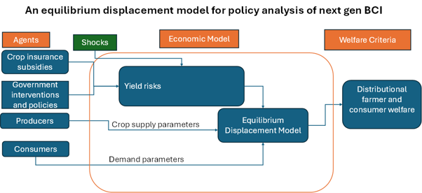
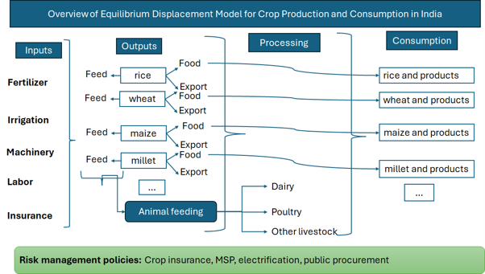
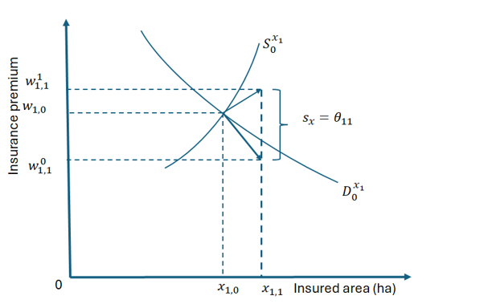

# EDM-BCI: An Equilibrium Displacement Policy Simulator for Next Gen BCI

## Summary
EDM-BCI is an equilibrium displacement modeling tool for simulating economic, food security, government fiscal savings,
and environmental impacts of repurposing risk management subsidies towards next gen bundled crop insurance products.

The workflow for the economic modeling engine considers how agents respond to shocks resulting in endogenous price and quantity changes.

## EDM Commodity Production and Consumption Structure 

## EDM: Demand and Supply Mathematical Relations

## Conclusion

## Acknowledgements 
We acknowledge financial support from the People of the United States through US Government support to global food security. We also acknowledge support from the Sustainable Farming program of the CGIAR. All errors are our own.

## References 
Lusk, J.L. 2016. “Distributional effects of crop insurance subsidies”. Applied Economic Perspectives and Policy 39 (1): 1-15. Doi:  https://doi.org/10.1093/aepp/ppw002.

Lusk, J.L. 2018. “Distributional effects of selected farm and food policies: effects of crop insurance, SNAP and ethanol promotion.” Url: https://www.mercatus.org/research/working-papers/distributional-effects-selected-farm-and-food-policies-effects-crop. 

